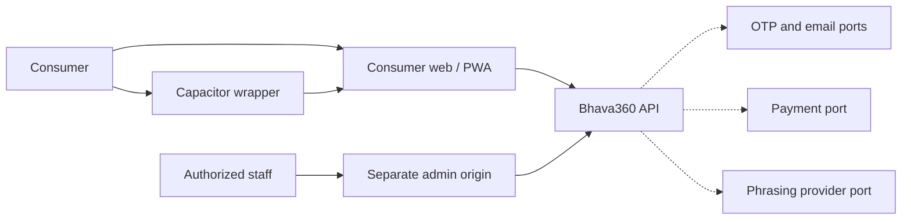
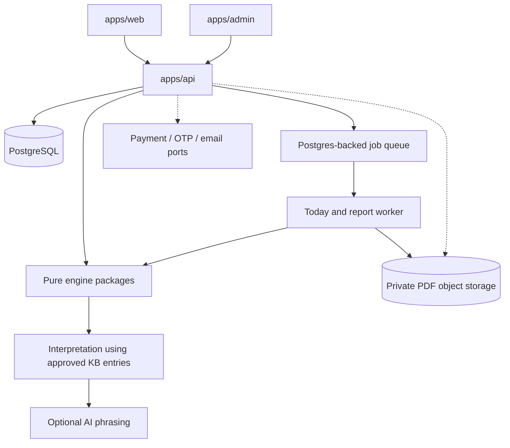

# System architecture

Bhava360 starts with three independently built applications. The current public API exposes health status. The following design shows the intended data paths as later issues add storage and computation.

## Context

## Containers

## Module contract

Each engine exports an implementation of `EngineModule<Input, Facts>` from `packages/core`. Its ID identifies the system. Its typed input keys and fact schema describe its boundary. The descriptor declares consuming screens, a translation namespace and a feature flag. The caller resolves input conventions and injects an explicit `ZonedClock` with a UTC instant and IANA time zone into `computeFacts(input, clock)`. An engine cannot read ambient time, use host-local calendar math, call a network service or render UI. The five descriptors currently have empty fact schemas and throw on computation. Later modules follow the same contract and remain off until enabled.

| Product area | Owner and boundary |
|---|---|
| Accounts, consent and privacy | API owns writes and session checks. Core carries public DTOs. DB persists the records in issue 02. |
| Languages and shared presentation | i18n owns EN/KN/HI keys, ui owns shared primitives. Optional locales remain disabled and fall back to English. |
| Vedic and Western | engine-vedic and engine-western produce convention-tagged facts for the interpretation layer. |
| Numerology, palmistry and tarot | engine-numerology, engine-palmistry and engine-tarot accept their own typed inputs. |
| Home, Today and Panchang | Consumer web composes API projections for the requested city and calendar day. |
| Life areas and check tools | Interpretation composes approved reasons across named systems. API separates public copy from technical evidence. |
| Ask and reports | API coordinates interpretation and optional ai phrasing. A worker renders reports. |
| Payments and notifications | Server-side payment and message ports. Worker handles delivery and idempotency. |
| Admin Portal | Separate apps/admin bundle and staff origin. Staff routes live in apps/api. The consumer app may only import public contracts. |
| Mobile | apps/mobile wraps apps/web with Capacitor. Android first, then iOS. Admin stays web-only. |
| Later Lal Kitab, Vastu and face modules | Future engine descriptors behind individual feature flags; published KB content alone cannot enable them. |

## Data flows

1. **Birth reading.** Resolve original local date, time and place against IANA historical rules once at intake. Retain the original inputs, zone and resolved UTC instant. Unknown time uses local noon with a separate uncertainty flag that suppresses Lagna-dependent facts. Engines return facts; interpretation selects approved KB rules and produces reasons. Optional AI receives authorized phrasing inputs; mark only its sentences ✦ AI. Project the public result before sending it to the screen.
2. **Today.** The device stores the chosen city and supplies its city identifier for a request. Resolve today's calendar date in that city's zone. Pre-generate eligible readings in the worker and check the cache before synchronous computation. Keep raw GPS out of PostgreSQL.
3. **PDF report.** An authorized request enqueues an idempotent report job in PostgreSQL. The worker loads the authorized profile and versioned inputs, interprets facts, renders the localized public projection and writes the PDF to private object storage. Return status and a short-lived download link after rechecking ownership. Retry transient failures with bounded backoff and record sanitized failure status.

Cache by profile ID and revision, convention, local date, place, language, module and KB version. Authorization precedes cache reads. Keep public and staff projection namespaces distinct. Invalidate on a profile edit or publication change. Queue leases and idempotency keys let workers retry interrupted jobs.

## Operations

Select development, staging or production with APP_ENV. Isolate data, credentials, origins and job namespaces per environment. Development uses synthetic fixtures and local ports. Configure admin on its own host and exclude it from public robots indexing and sitemap generation. Robots directives are discovery hints; authenticated staff access will be enforced by the API. See [security architecture](security.md).

Run `pnpm test`, `pnpm typecheck`, `pnpm check:i18n` and `pnpm build` locally. Production build runs locale and type checks before building API, web and admin sequentially. Always run the existing Python validator. See the [decision records](adr/).
