# Local database schema

The Drizzle models in `packages/db/src/schema` describe 44 domain tables. The reviewed SQL pair in `packages/db/drizzle` is the executable migration. The CLI applies ordered migrations inside a transaction under a database advisory lock. Repeated up/down calls are safe. A down migration drops domain data; use a disposable local database.

```mermaid
erDiagram
  users
  places
  users ||--o{ identities : user_id
  identities ||--o{ otp_challenges : identity_id
  users ||--o{ sessions : user_id
  users ||--o{ consents : user_id
  users ||--o{ profiles : user_id
  places ||--o{ profiles : place_id
  profiles ||--o{ computation_cache : profile_id
  profiles ||--o{ readings : profile_id
  profiles ||--o{ ai_generations : profile_id
  profiles ||--o{ ask_threads : profile_id
  ask_threads ||--o{ ask_messages : thread_id
  users ||--o{ matches : user_id
  profiles ||--o{ matches : first_and_second_profile
  profiles ||--o{ muhurta_searches : profile_id
  places ||--o{ muhurta_searches : place_id
  profiles ||--o{ tarot_draws : profile_id
  tarot_draws ||--o{ tarot_journal : draw_id
  profiles ||--o{ numerology_names : profile_id
  profiles ||--o{ palm_sessions : profile_id
  reports
  profiles ||--o{ report_orders : profile_id
  reports ||--o{ report_orders : report_id
  report_orders ||--o{ report_books : order_id
  report_orders ||--o{ payments : order_id
  users ||--o{ subscriptions : user_id
  users ||--o{ entitlements : user_id
  notifications
  users ||--o{ notification_preferences : user_id
  users ||--o{ notification_inbox : user_id
  notifications ||--o{ notification_inbox : notification_id
  profiles ||--o{ check_requests : profile_id
  profiles ||--o{ explanations_cache : profile_id
  feature_flags
  rule_catalogue
  staff_users
  staff_users ||--o{ staff_sessions : staff_id
  staff_users ||--o{ staff_mfa_devices : staff_id
  staff_users ||--o{ staff_recovery_codes : staff_id
  rule_catalogue ||--o{ kb_entry_reviews : entry_id
  staff_users ||--o{ kb_entry_reviews : actor_id
  rule_catalogue |o--o{ native_review_items : entry_id
  staff_users |o--o{ native_review_items : reviewer_id
  staff_users ||--o{ inspector_access_log : actor_id
  staff_users ||--o{ staff_ip_allowlist : staff_id
  audit_log
  users ||--o{ feedback : user_id
  users ||--o{ data_requests : user_id
  report_orders ||--o{ report_jobs : order_id
```

## Running locally

Run setup, activate the toolchain described in the root README, then run `pnpm test` as a regular OS user. The database suite starts actual PostgreSQL in a temporary directory with random credentials on a loopback port, runs up, seeds twice, exercises constraints, deletes a fixture account, runs down then up, and stops the cluster. It ignores the ambient DATABASE_URL. PostgreSQL binaries are installed as test dependencies during setup. No Docker service or external database is required.

For manual development, supply DATABASE_URL for an existing disposable local database. Run `pnpm db:migrate`, then `APP_ENV=development pnpm db:seed`. Use `pnpm db:down` to discard the migrated schema. Only PostgreSQL URLs with a single database name, no query overrides, and a literal loopback host or localhost are accepted. The client connects to a numeric loopback address. Use an actual local server; never forward the port to hosted Postgres. Kiran handles hosted approvals separately.

## Ownership and retention

The API will enforce ownership in the query layer. Its service account must not own the schema. Consumer access always starts from the authenticated user ID and joins through the foreign keys above, including on writes. A supplied profile or order ID alone grants no access. Matches enforce both profile owners using composite foreign keys. Staff sessions have their own token space and authorization checks. Only explicitly allowlisted public fields may leave consumer endpoints.

| Tables | Retention and access rule |
|---|---|
| users | On a deletion request deactivate immediately and schedule hard deletion within 30 days in the same transaction. Deny access from deactivation onward. The schema bounds the deadline; the worker is future work. |
| identities, otp_challenges, sessions, consents | Cascade at account deletion. Purge expired challenges and sessions regularly. Keep versioned consent decisions for the life of the account. Store normalized email or E.164 phone lookup as a keyed digest in production; use separate keyed hashes for short OTPs and IPs and high-entropy session token digests. Never log inputs. |
| profiles, places | Profiles cascade with the account. Shared gazetteer rows survive account deletion and restrict deletion while referenced. Coordinates describe cities. Preserve local input, IANA zone, resolved UTC instant and precision. Unknown uses local noon. |
| computation_cache, explanations_cache, readings, ai_generations | All cascade with profile. Evict expired computations and obsolete explanations by fact hash. AI history is limited to provider, model, template version and timestamp. |
| ask_threads, ask_messages, matches, muhurta_searches, tarot_draws, tarot_journal, numerology_names | Cascade with their owner, profile or parent item. Future writes to Ask require active AI consent, checked in the write transaction. |
| palm_sessions, check_requests | Cascade with profile. External image pointers require explicit opt-in and a deletion deadline. Future workers must erase external objects at expiry or account deletion. Check input persistence requires explicit save; mobile and vehicle numbers are excluded by default. |
| reports, report_orders, report_books, payments, subscriptions, entitlements, report_jobs | Shared report catalogue persists. Orders and their books, jobs and provider references cascade on profile deletion; subscriptions and entitlements cascade with the account. Remove book objects on deletion. Keep price data in purchase/admin projections only. |
| notifications, notification_preferences, notification_inbox | Shared templates persist; preferences and inbox cascade with user. |
| feedback, data_requests | Cascade with user. Process export/delete requests by deadline and use an opaque audit target after completion. |
| feature_flags, rule_catalogue | Shared configuration persists independently. Per-environment flags and unique dotted rule IDs are indexed. KB references point into source YAML. Approval is an overlay: draft → in_review → validated → approved. Issue 04 checks actor permissions and transitions; only owner publishes. |
| staff_users, staff_sessions, staff_mfa_devices, staff_recovery_codes, staff_ip_allowlist | Disable staff at expiry. Revoke expired sessions; cascade factors, allowlist entries and sessions on staff removal. Encrypt TOTP secrets with a versioned key outside the DB. Recovery codes are single-use digests. Review references restrict deletion of staff with retained history. |
| kb_entry_reviews, native_review_items | Retain review history with its catalogue target. Native proposals target exactly one KB entry or i18n key. Preserve author attribution for staff oversight. |
| inspector_access_log, audit_log | Use opaque target identifiers with no link to identifiable birth records after deletion. Staff access only. Keep audit at least 18 months; application permissions exclude edits, deletes and truncate. A trigger rejects all three. Grant only SELECT/INSERT as appropriate. Reserve retention maintenance for an independent operator. Allowlist non-secret change fields and sanitize reasons and user agents before writing events. |
| bhava_migrations | Operational version ledger survives down so later up can run. |

Foreign-key indexes support ownership joins and cascades. Additional indexes cover aliases, queue availability, challenge expiry, unique lookup digests and localized cached explanations. Support tickets and anonymous analytics are deferred to R2. Live impersonation is excluded.

## Synthetic development data and conventions

Seeding requires an explicit development or test APP_ENV. Five synthetic accounts use deterministic IDs and example.test email digests. No address or phone is needed in plaintext. Fixture digests use public test inputs and must never be reused for real identity lookup. Dev has two profiles to distinguish known noon from unknown time. The seed resolves fixture instants with PostgreSQL's IANA time zone history. Seven city rows include the five birthplaces and Mangaluru/Mangalore and Kalaburagi/Gulbarga. Native labels are pending review. Six synthetic staff rows have no credentials.

Up installs settings for development, staging and production. Vedic houses are whole-sign, Western houses Placidus, and matching defaults to Ashtakoota with Porutham available. Modern outer planets are off and remain display-only if enabled later; never feed them into Vedic or KP calculations. EN/KN/HI are enabled. TE/TA/ML/ES/FR are off. Vedic is enabled for MVP. Numerology is off until R2. Western, tarot, palmistry, Lal Kitab, Vastu and face are gated off until release approval.

Migration 002 adds the session locale and active profile, OTP creation timestamps, shared OTP throttle buckets and profile soft-deletion/permission fields. Buckets store keyed digests and expire from the limiter after ten minutes; subsequent traffic purges rows older than a day. Soft-deleted profiles are excluded from reads, switches and the free-plan count. Account hard deletion still cascades through those profiles.
